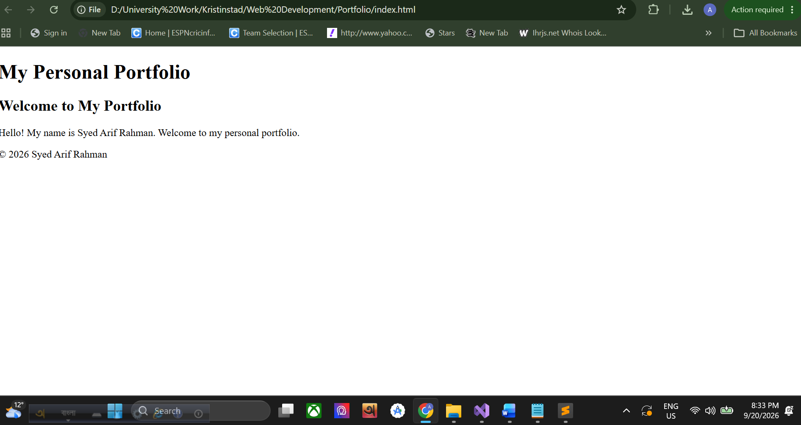
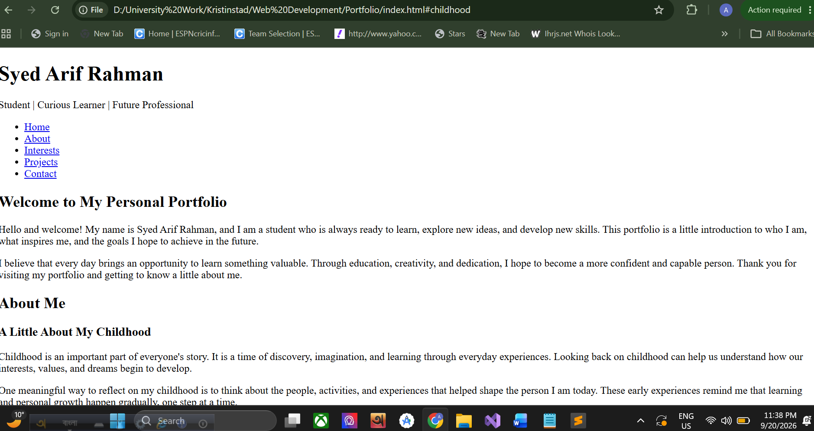
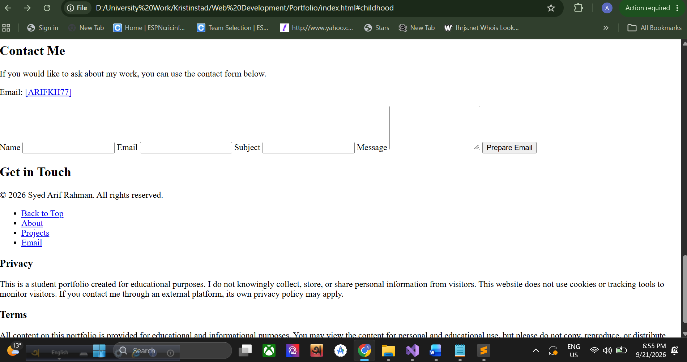
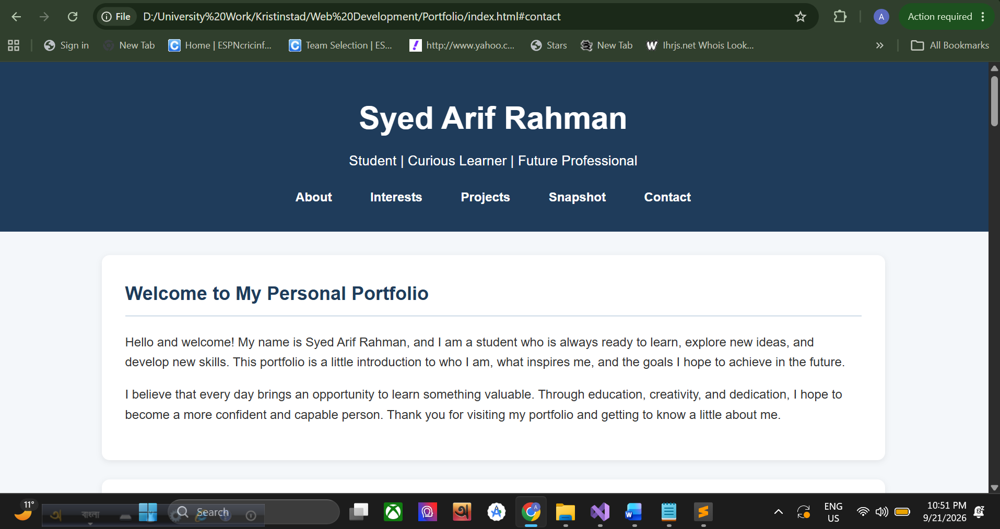
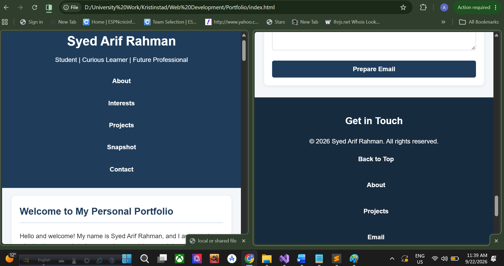
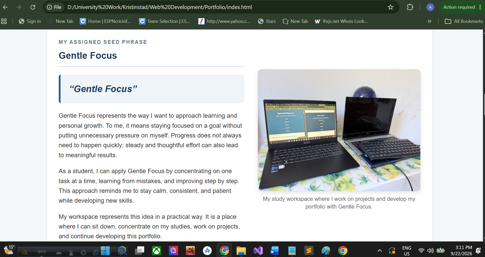
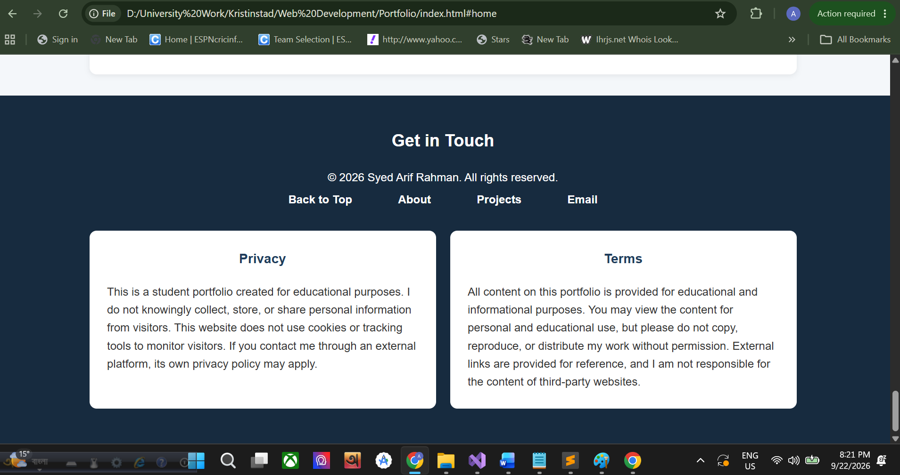
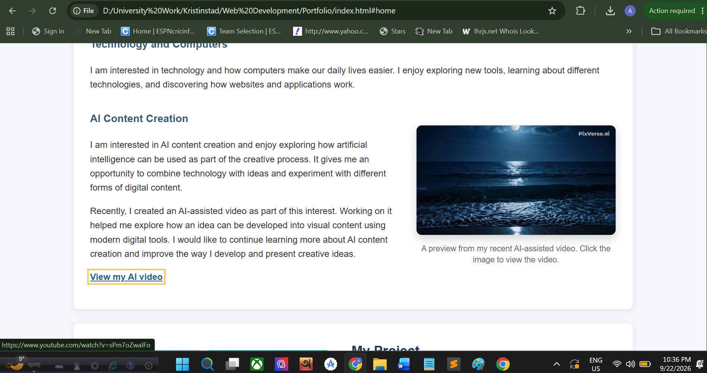

Build Log --- Grade 3 (One-Page Personal Portfolio)

Student: Syed Arif Rahman
Project: Personal Portfolio

1.  Initial HTML Structure

	Screenshot filename: `01-structure.png`
	Actual date and time: `20/09/2026 - 20:33 PM`

		
	
		

	What changed (specific)

	I created the initial semantic HTML5 structure for my personal
	portfolio. I added the main page elements, including the `header`,
	`main`, `section`, and `footer`. I also added the page title,
	introductory content, and linked an external CSS file so that the
	styling could be developed separately.

	What I learned / next step

	I learned how semantic HTML elements help organise a webpage into clear
	sections. My next step was to add navigation and develop the personal
	biography content.

------------------------------------------------------------------------

2. Navigation and About Me

	Screenshot filename: `02-navigation-about.png`
	Actual date and time: `20/09/2026 - 23:38 PM`

	

	What changed (specific)

	I added internal navigation links for Home, About Me, Childhood, My
	Interests, and Future Goals. I also expanded the page with an
	introduction and personal biography sections, including childhood,
	interests, and future goals.

	What I learned / next step

	I learned how anchor links and section IDs can be used to navigate
	between different sections of a single-page website. My next step was to
	add more portfolio content and use a wider range of HTML elements.

------------------------------------------------------------------------

3. Interests, Projects and Learning Content

	Screenshot filename: `03-content(01).png`,`03-content(02).png`
	Actual date and time: `21/09/2026 - 18:25 PM`,`21/09/2026 - 18:26 PM`			

	.png)
    .png)

	What changed (specific)

	I added interests, project content, image placeholders, a relevant
	external link, and a learning snapshot table. These additions made the
	portfolio more informative and allowed me to organise different types of
	content using suitable HTML elements.

	What I learned / next step

	I learned how elements such as articles, images, links, and tables can
	be used for different purposes within a webpage. My next step was to
	complete the main HTML content by adding a contact form and a more
	detailed footer.

------------------------------------------------------------------------

4. Contact Form and Footer

	Screenshot filename: `04-form-footer.png`
    Actual date and time: `21/09/2016 - 18:55 PM`

	

	What changed (specific)

	I added a contact form with fields for name, email, subject, and
	message. I also expanded the footer with contact information, copyright
	text, navigation links, and Privacy and Terms placeholders.

	What I learned / next step

	I learned how form labels and input fields are structured and how a
	footer can provide useful secondary information. My next step is to
	begin the visual styling of the portfolio with CSS.

------------------------------------------------------------------------

5. Initial CSS Styling		

	Screenshot filename: `05-initial-css.png`
    Actual date and time: `21/09/2026 - 22:52 PM`

	

	What changed (specific)					

	I added the first visual styling to my portfolio using an external CSS file. 
    I styled the header and navigation, added consistent colours and spacing,
    created card-style sections, and improved the appearance of the table, contact 
    form, buttons, links, and footer. I also added hover and keyboard focus states 
    to make interactive elements clearer.

	What I learned / next step

	I learned how CSS can transform the appearance of the same HTML structure without
    changing the page content. I also learned how spacing, colours, borders, and hover
    and focus states can improve the visual organisation and usability of a webpage. 
    My next step is to make the design responsive for smaller screens using a media query.

------------------------------------------------------------------------

6. Responsive Design			

	Screenshot filename: `06-responsive.png`
    Actual date and time: `22/09/2026 11:39 AM`

	

	What changed (specific)		

	I added responsive CSS using media queries for tablet and mobile screen sizes. I changed 
    the navigation from a horizontal layout to a vertical layout on smaller screens, reduced 
    the spacing and font sizes, adjusted the main content width, made the contact button full-width, 
    and allowed the table to scroll horizontally when necessary.

	What I learned / next step		

	I learned how media queries allow the same webpage to adapt to different screen sizes. 
    I also learned that a desktop layout may need changes to navigation, spacing, tables, 
    and form controls to remain usable on smaller screens. My next step is to add my original 
    visual content and incorporate the assigned seed into the portfolio.

------------------------------------------------------------------------

7. Original Images and Seed

	Screenshot filename: `07-seed-images.png`
	Actual date and time: `22/09/2026 15:12 PM`

	

	What changed (specific)

	I added three original visuals to relevant parts of my portfolio instead
	of placing them together in a separate gallery. I placed my recent
	photograph beside the About Me content, an image of my Online Examination
	System along with the project title and description, and my workspace photograph beside
	the “Gentle Focus” section. I also incorporated my assigned seed phrase,
	“Gentle Focus,” into the content and connected it to my approach to
	studying and personal development.

	What I learned / next step

	I learned that images can communicate more effectively when they are
	placed beside related content rather than separated into a general
	gallery. I also learned how Flexbox can create a text-and-image layout
	while media queries can rearrange the same content for smaller screens.
	My next step is to test the complete portfolio in different browsers and
	screen sizes and make final refinements.

------------------------------------------------------------------------
8. Final Testing, Seed Integration and Design Refinements

	Screenshot filename: `08-tested-final.png`  
	Actual date and time: `22/09/2026 20:21 PM`,`22/09/2026 22:36 PM`	

	
    

	What changed (specific)

	During the final review of my portfolio, I made several small improvements
	to strengthen the design, improve readability, and make my assigned seed
	phrase, “Gentle Focus,” more meaningful throughout the website.

	Earlier, Gentle Focus was mainly presented in its own dedicated section.
	During the final review, I decided to connect the seed to other relevant
	parts of my portfolio. I added references to Gentle Focus in my introduction
	and About Me content, where it relates to gradual personal growth, patience,
	and steady progress toward my future goals. I also created a reusable
	`seed-highlight` CSS class so that the phrase is visually noticeable and
	consistent wherever it appears.

	I also improved the visual hierarchy of my Learning Snapshot table by
	changing its caption to an `h3` heading. This made the table title clearer
	and helped it fit better with the heading structure used throughout the
	portfolio.

	Another improvement was made to the Privacy and Terms content in the
	footer. During testing, I noticed that the text needed better contrast and
	that displaying the two sections one above the other used more vertical
	space than necessary on larger screens. I corrected the text colours and
	changed the desktop layout so that Privacy and Terms appear side by side.
	For smaller screens, the responsive layout places them vertically again
	so that the content remains easy to read.

	I also updated the third item in my Interests section from Creative Design
	to AI Content Creation because it better represents one of my current
	interests. I added a preview image from a recent AI-assisted video that I
	created and placed it beside the related text. I made the image clickable
	so that visitors can open and view the video through an external link.
	I also included a text link to the same video and added useful alternative
	text to the preview image. This allowed the visual, written content, and
	external resource to work together instead of adding an unrelated external
	link elsewhere on the page.

	Finally, I added small visual refinements such as accent details below
	section headings and subtle hover effects for images and buttons. I also
	corrected minor HTML and email-link issues and checked that the new video
	link and clickable preview worked correctly.

	Testing

	I tested the website in:

	- Google Chrome
	- Microsoft Edge
	- Mobile/responsive view

	I checked the navigation links, responsive layout, original images,
	Gentle Focus references and highlighting, Learning Snapshot table,
	project content, AI Content Creation section, clickable video preview,
	external video link, contact form, email links, footer, and the responsive
	Privacy and Terms layout.

	What I learned / next step

	I learned that final testing is not only about finding errors but also
	about noticing small opportunities to improve the design. Changing the
	table caption to a heading improved the content hierarchy, while placing
	Privacy and Terms side by side made better use of space on larger screens.

	I also learned that responsive design sometimes requires different layout
	choices for different screen sizes. The side-by-side footer layout works
	well on desktop, while stacking the same sections on mobile keeps them
	readable. Integrating Gentle Focus into relevant content also helped me
	understand how a design idea can become a consistent theme rather than
	remaining isolated in one section.

	Adding my AI Content Creation work also helped me understand that an
	external link can be part of the actual portfolio content rather than
	being added only to meet a requirement. Connecting the video preview,
	description, and external link made the Interests section more personal
	and gave visitors a direct example of something I have recently created.

